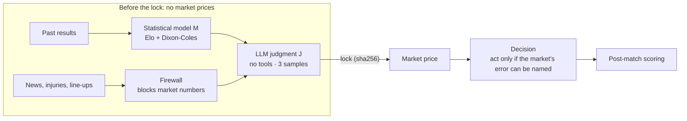
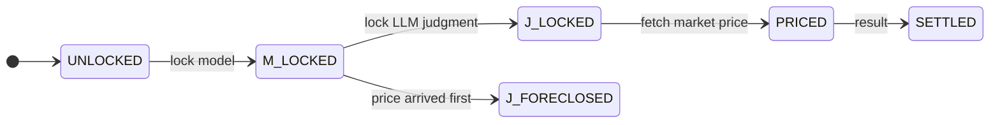

# Football Prediction System

**Keeping an LLM inside verifiable boundaries: a probability forecasting system for football matches.**

[One-page overview](https://claude.ai/artifact/49oze3y8pgsxs5vnwC52SF) · [Slides (PDF, Chinese)](docs/WC2026.pdf) · [中文](README.md)

Ask an AI "who will win" and you get a fluent answer nobody can check. This system splits the work: a statistical model sets the baseline, an LLM reads news and line-ups, and code owns the arithmetic and the rules. Each match's estimate is locked before it is compared with the market price, then scored against the result. It ran live through the 2026 World Cup knockout stage and now covers the Premier League 2026-27 season.

## Highlights

- **Isolated LLM.** Its only inputs are the model's probabilities, verified evidence and a frozen spec. All tools are disabled and it never sees a market price.
- **Code-enforced process.** A state machine decides which step is allowed; a forbidden action is refused, not left to the model's discipline.
- **Verifiable results.** Predictions are locked with a sha256 into an append-only ledger. 37 modules test their own guards by planting faults.

## Architecture



- **J** runs as `claude -p`. Code recomputes its probabilities from the factors it lists and rejects a sample that does not match.
- **The decision** requires a concrete mechanism for why the market is wrong. Without one the system does not act, however large the gap, and must state what information is missing.
- A separate analyst layer may use all data; when it disagrees with J, the disagreement is recorded, never overwritten.

### State machine



If a market price arrives first, that match's LLM judgment is void for good (`J_FORECLOSED`). The price fetcher therefore refuses to fetch early for fixtures that are not locked.

### Where code guards the process

| Gate | Stops | Where |
|---|---|---|
| Lock | locking after kickoff, re-locking, edits without new information | `competitions/epl_2026_27.py` |
| Price fetch | fetching early for fixtures that are not locked | `data/the_odds_api.py`, `competitions/ops.py` |
| Firewall | market numbers hidden in the evidence | `evidence/firewall.py`, `evidence/schema.py` |
| LLM output | probabilities that do not follow from its own factors, missing verification checks | `research/j_runner.py` |
| Decision | a "no action" without a reason (marked `UNFINISHED`) | `decision/sop.py` |
| Selftest | a guard that misses a planted fault, archived numbers that do not recompute | `audit/selftest.py` |

## Results

RPS measures the error of a probability forecast; lower is better. The closing price is the last market price before kickoff and usually the hardest benchmark to beat.

| Test | Result | Conclusion |
|---|---|---|
| World Cup knockouts, rules registered in advance (15 matches) | model RPS 0.1621 vs closing price 0.1972; model better in 11 of 15 | A positive signal, but too small a sample to prove anything |
| Premier League, 970 matches outside the training range | model worse than the close by 0.0075; the bigger the gap, the more often the model is the one that is wrong | Overturned "a big gap is an opportunity"; it is now a warning built into the system |
| Auditing the LLM's reasons | the LLM's most-used reason happened as written 2 times out of 22 | A plausible reason is not a realised one; check each one |

Full verdict: [`FINAL_REPORT.md`](history/falsification-2026/FINAL_REPORT.md). Rules registered in advance: [`PROTOCOL.md`](history/falsification-2026/PROTOCOL.md) (both Chinese).

## Run it

```bash
pip install -r requirements.txt                     # Python 3.13
python -m football_ai.audit.selftest                # all self-tests, incl. bit-identical recompute of the World Cup numbers
python -m football_ai.decision.report m104_esp_arg  # re-run the decision report for the World Cup final
```

In the final's report the model shows a +14.7% apparent expected value on the away side, and the decision is still not to act, because no market error can be named. On Windows, set `PYTHONIOENCODING=utf-8` first.

## Where to read

| File | What it shows |
|---|---|
| [`football_ai/research/j_runner.py`](football_ai/research/j_runner.py) | isolated LLM execution and output validation |
| [`football_ai/evidence/firewall.py`](football_ai/evidence/firewall.py) | market-number detection |
| [`football_ai/competitions/matchflow.py`](football_ai/competitions/matchflow.py) | the state machine |
| [`football_ai/audit/selftest.py`](football_ai/audit/selftest.py) | planted-fault self-tests |
| [`CLAUDE.md`](CLAUDE.md), [`.claude/workflows/`](.claude/workflows/) | rules for coding agents and multi-agent workflows |
| [`football_ai/README.md`](football_ai/README.md) | package layering and dependency rules (Chinese) |

## About this copy

Exported automatically from a private repository. Season ledgers and personal money records are not published; edited spots are marked 〔公開版編註〕 ("public-copy note"). The scheduled job is off by default. Data: football-data.co.uk, martj42/international_results, eloratings.net, Understat, The Odds API.

Jason Wang · 2026.10
