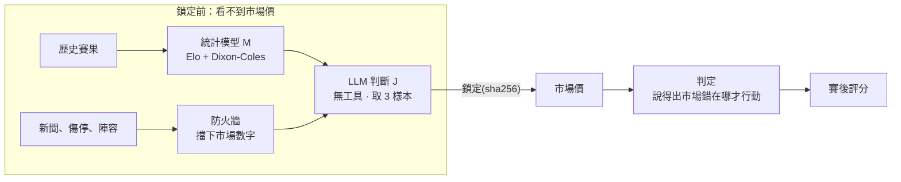
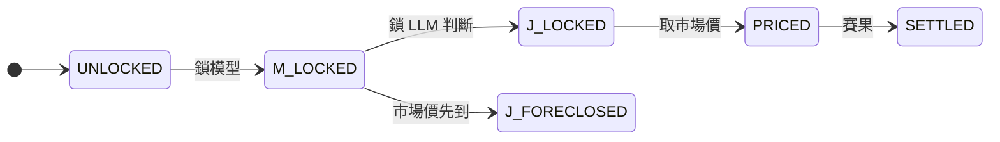

# 足球預測系統

**讓 LLM 在可驗證的邊界內工作：一套足球比賽機率預測系統。**

[一頁介紹](https://claude.ai/artifact/49oze3y8pgsxs5vnwC52SF) · [簡報 PDF](docs/WC2026.pdf) · [English](README.en.md)

直接問 AI「誰會贏」，得到的是流暢但無法驗證的答案。這個系統把工作拆開：統計模型算基準、LLM 讀新聞與陣容、程式負責算術與規則。每場的估計先鎖定，再和市場價比較，最後用賽果檢驗。實戰跑過 2026 世界盃淘汰賽，現在用於英超 2026-27 賽季。

## 重點

- **LLM 隔離執行**：輸入只有模型機率、經過驗證的證據與固定的規格；停用所有工具，看不到市場價。
- **流程由程式強制**：狀態機決定每一步能不能做；違規的動作直接被拒絕，不靠模型自覺。
- **結果可驗證**：預測先鎖定、記下 sha256，寫進只增不改的帳本；37 個模組各自用植入的錯誤測試防護是否有效。

## 架構



- **J** 以 `claude -p` 執行。程式用 J 自己列出的因子重算機率，對不上就退回。
- **判定**要求寫出市場錯誤的具體機制；寫不出來，差距再大也不行動，並須說明缺什麼資訊。
- 另有一層可用完整資料的研判；它和 J 意見不同時必須記錄，不能覆蓋。

### 狀態機



市場價一旦先進來，這場的 LLM 判斷就永久作廢(`J_FORECLOSED`)。所以取價程式會拒絕為還沒鎖定的場次提早抓價。

### 程式把關的地方

| 關卡 | 擋下什麼 | 位置 |
|---|---|---|
| 鎖定 | 開球後鎖定、重複鎖定、沒有新資訊的修改 | `competitions/epl_2026_27.py` |
| 取價 | 為還沒鎖定的場次提早抓市場價 | `data/the_odds_api.py`、`competitions/ops.py` |
| 防火牆 | 證據裡夾帶市場數字 | `evidence/firewall.py`、`evidence/schema.py` |
| LLM 輸出 | 機率和自己列出的因子對不上、缺少驗證條件 | `research/j_runner.py` |
| 判定 | 決定不行動卻沒寫理由，標記 `UNFINISHED` | `decision/sop.py` |
| 自測 | 防護沒擋下植入的錯誤、封存數字重算不一致 | `audit/selftest.py` |

## 結果

RPS 是機率預測的誤差，越低越準。收盤價是開賽前最後的市場價，通常是最難贏的基準。

| 驗證 | 結果 | 結論 |
|---|---|---|
| 世界盃淘汰賽，規則事先登記(15 場) | 模型 RPS 0.1621，收盤價 0.1972;15 場中 11 場模型較準 | 有正向訊號，但樣本太小，不構成證明 |
| 英超 970 場，訓練範圍外的資料 | 模型比收盤價差 0.0075；兩者差距越大，模型越常是錯的那方 | 推翻了「差距大就是機會」，改成警訊寫進系統 |
| LLM 理由的事後對帳 | LLM 最常用的理由，22 次只有 2 次照它寫的方式發生 | 理由合理不代表會發生，要逐條對帳 |

完整判定：[`FINAL_REPORT.md`](history/falsification-2026/FINAL_REPORT.md)。事先登記的規則：[`PROTOCOL.md`](history/falsification-2026/PROTOCOL.md)。

## 執行

```bash
pip install -r requirements.txt                     # Python 3.13
python -m football_ai.audit.selftest                # 全部自測，含世界盃數字逐位重算
python -m football_ai.decision.report m104_esp_arg  # 重跑世界盃決賽的判定報告
```

決賽報告裡，模型算出客隊有 +14.7% 的表面期望值，判定仍是不行動，因為說不出市場錯在哪。Windows 先設 `PYTHONIOENCODING=utf-8`。

## 從哪裡讀

| 檔案 | 看什麼 |
|---|---|
| [`football_ai/research/j_runner.py`](football_ai/research/j_runner.py) | LLM 的隔離執行與輸出驗證 |
| [`football_ai/evidence/firewall.py`](football_ai/evidence/firewall.py) | 市場數字偵測 |
| [`football_ai/competitions/matchflow.py`](football_ai/competitions/matchflow.py) | 狀態機 |
| [`football_ai/audit/selftest.py`](football_ai/audit/selftest.py) | 植入錯誤的自測 |
| [`CLAUDE.md`](CLAUDE.md)、[`.claude/workflows/`](.claude/workflows/) | 給 coding agent 的規則與多 agent 工作流程 |
| [`football_ai/README.md`](football_ai/README.md) | 程式分層與依賴方向 |

## 關於這份公開版

由私有 repo 自動匯出。賽季帳本與個人資金紀錄不公開，刪改處標有「〔公開版編註〕」；排程預設停用。資料來源：football-data.co.uk、martj42/international_results、eloratings.net、Understat、The Odds API。

Jason Wang · 2026.10
